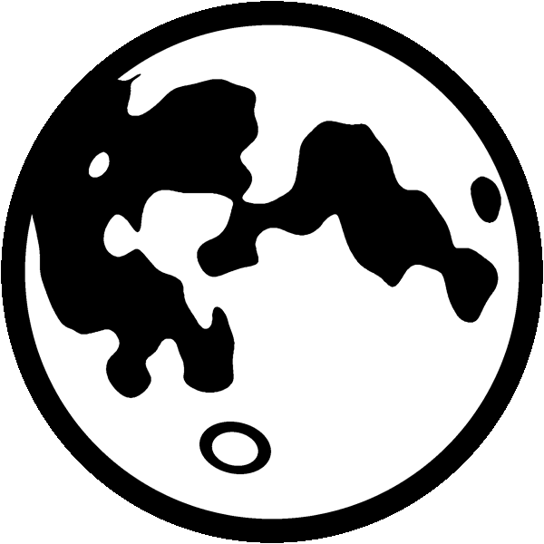
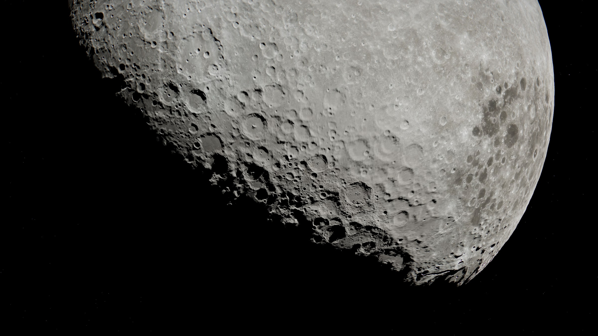
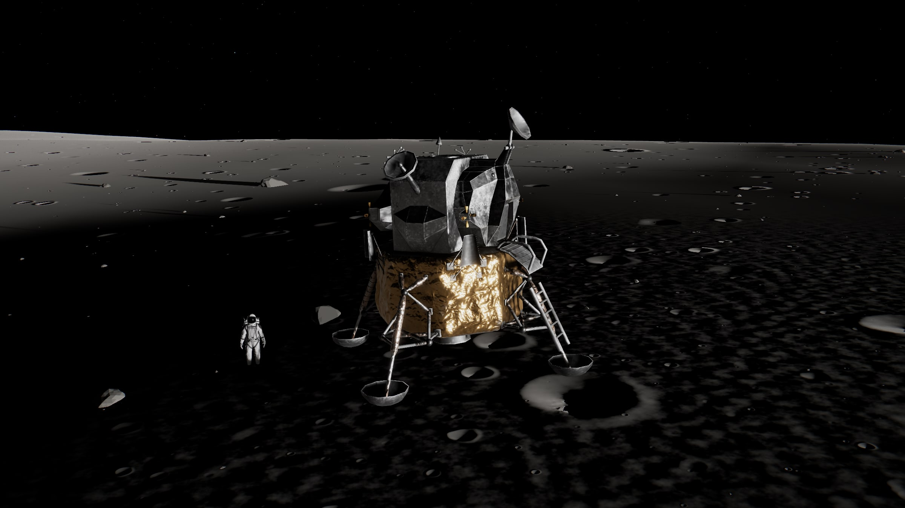
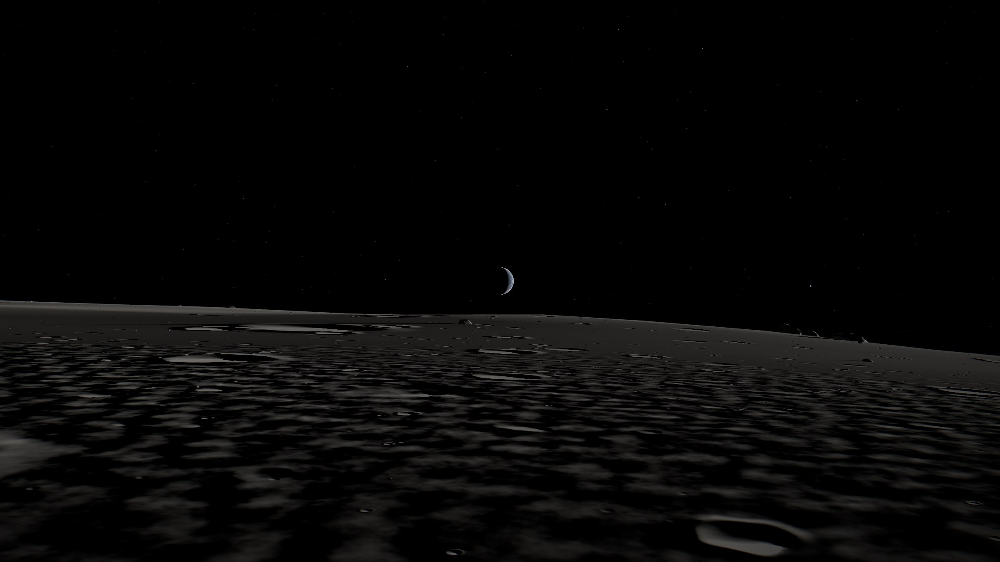
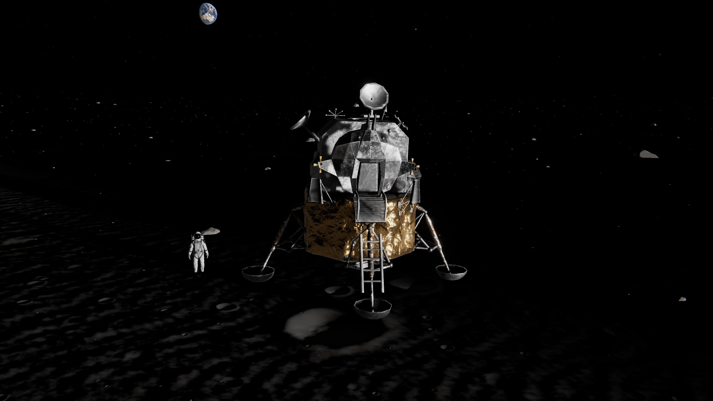
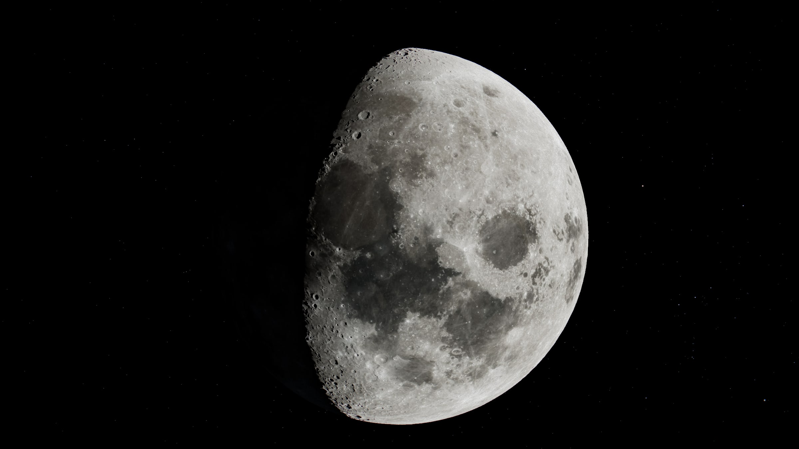
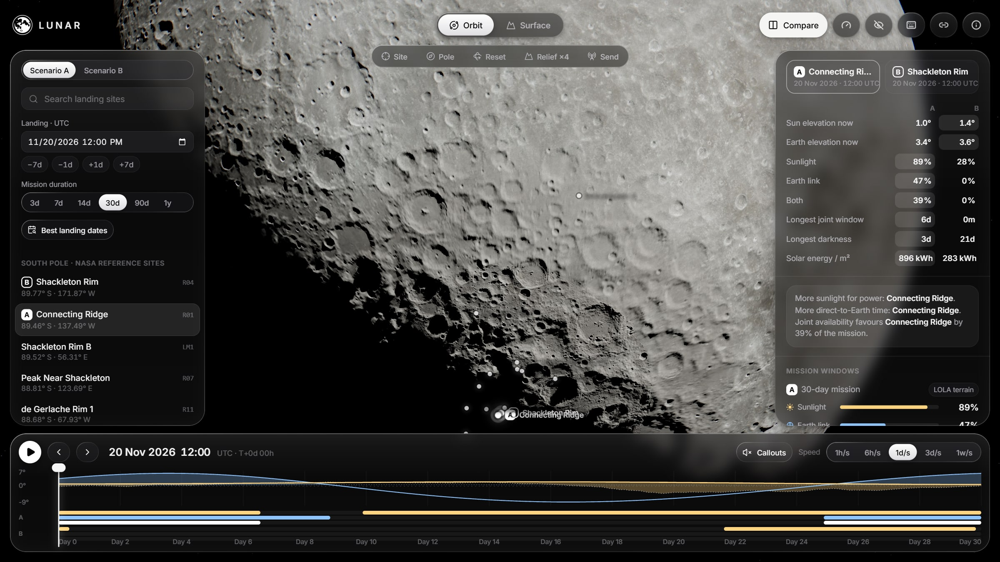
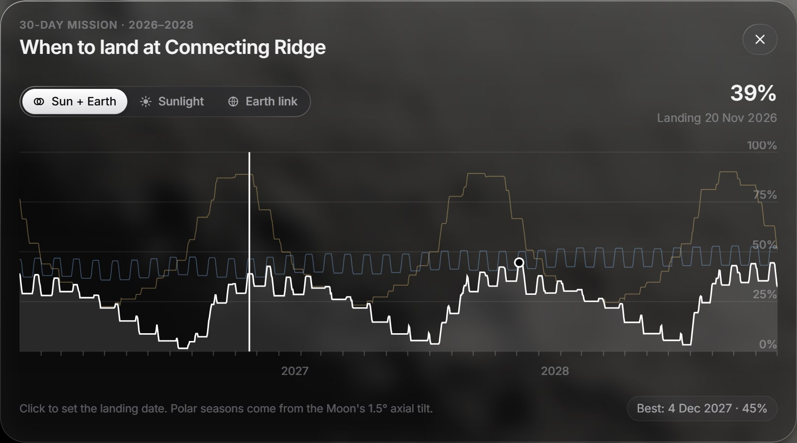
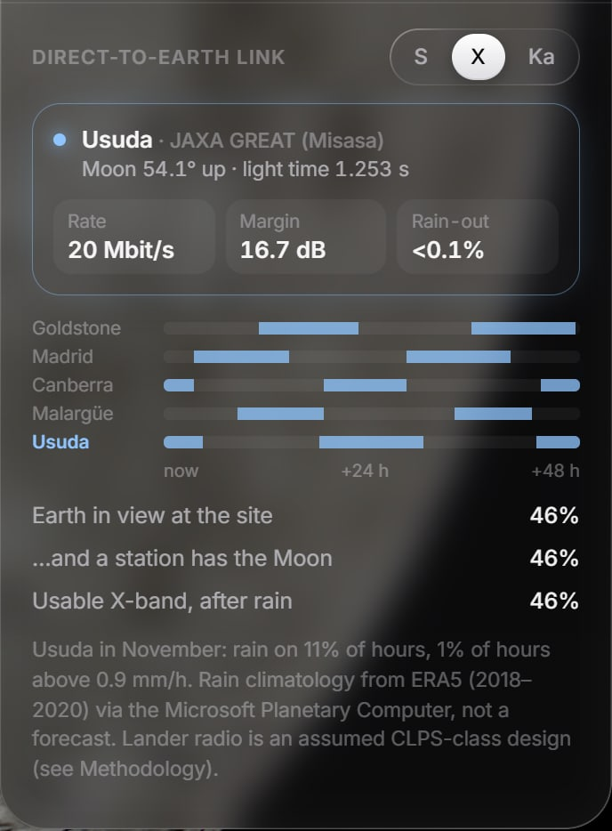
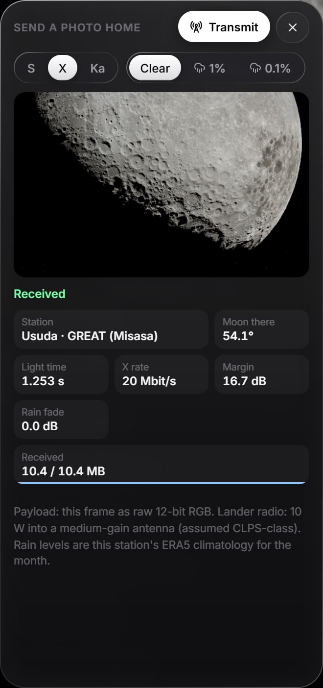

<div align="center">



# Eclipse

### Lunar Landing Site Navigator

Pick a spot on the Moon and a landing date. See when the Sun powers you, when Earth can hear you, and which antenna on Earth is listening.

[Live demo](https://sandeepshenoy.dev/projects/nsa26/) &nbsp;·&nbsp; [Challenge](https://www.spaceappschallenge.org/2026/challenges/lunar-landing-site-navigator/) &nbsp;·&nbsp; [How it works](#how-it-works) &nbsp;·&nbsp; [Validation](#validation) &nbsp;·&nbsp; [Security](#security-and-privacy) &nbsp;·&nbsp; [Run it](#running-locally)

NASA Space Apps Challenge 2026 &nbsp;·&nbsp; Team Voyager Z

<br />



<sub>The south pole on 20 November 2026, rendered live from LOLA heights and LROC colour, with shadows ray-marched toward the DE440 Sun.</sub>

</div>

---

## Overview

Near the lunar south pole the Sun never climbs more than a few degrees above the horizon, Earth bobs along the skyline, and a ridge 10 km away can decide whether a lander sees daylight. Moving the landing site a few kilometres, or slipping the launch by a week, can cost a mission half its power or most of its contact with Earth.

The tools that answer these questions today, such as Quickmap, Moon Trek and JPL Horizons, are powerful but built for specialists. Checking one site on one date means working across all three. Eclipse brings the answer onto a single screen in under a second, for any site and any date from 2026 to 2028, and lets users compare two scenarios side by side.

The project responds to the 2026 Space Apps challenge *Lunar Landing Site Navigator*, which asks for an intuitive tool that lets mission planners, educators and the public compare landing sites and dates by visualizing the Sun and Earth relative to the horizon, in order to assess power generation and direct-to-Earth communication windows.

<table>
<tr>
<td width="50%"><br /><sub><b>Connecting Ridge, 20 Nov 2026.</b> The Sun is 1° up, and every shadow points along its true azimuth.</sub></td>
<td width="50%"><br /><sub><b>Earth from the pole.</b> A crescent 3° above the horizon. The entire direct-to-Earth link depends on this sliver of sky.</sub></td>
</tr>
<tr>
<td width="50%"><br /><sub><b>Malapert Massif.</b> An Earth-facing slope keeps Earth high in the sky, which makes it a strong communications site.</sub></td>
<td width="50%"><br /><sub><b>The full Moon globe,</b> lit and oriented for 15 March 2027 from DE440.</sub></td>
</tr>
</table>

<sub>Scene-only renders. Press <b>H</b> in the app to hide the interface.</sub>

## Features

### Site analysis

**Sun and Earth over the real skyline.** Sun and Earth positions come from the NASA/JPL DE440 ephemeris and are measured against horizons ray-cast through LRO/LOLA terrain. Each body's path is drawn over the actual jagged skyline of the site, not over an idealized flat horizon.

**Power and communication at a glance.** For any site and mission window, Eclipse reports solar elevation, the share of the mission in sunlight, the share with Earth in view, the share with both at once, the longest joint window, the longest period of darkness, solar irradiance and energy per square metre.

**Time to sunset and Earthset.** Live countdowns, refined to the second, show operators how long they have before the Sun or Earth drops behind terrain.



<sub><b>Compare mode.</b> Connecting Ridge against Shackleton Rim, 15 km apart: 89% versus 28% sunlight and 47% versus 0% Earth link over the same 30 days.</sub>

### Mission planning

**Compare scenarios.** Two sites, two dates, or both can be placed side by side. The better value for each metric is highlighted, and the app summarizes the result in a plain-language verdict.

**Plan around launch slips.** Landing can be shifted by a day or a week, and a landing-date scan covers every day from 2026 to 2028 to find the best windows. The polar seasons produced by the Moon's 1.5° axial tilt appear clearly in the results.



<sub><b>Best landing dates.</b> Every landing day from 2026 to 2028 scored for sunlight, Earth link, or both. The seasonal waves come from the Moon's 1.5° tilt.</sub>

**Curated and custom sites.** The site library contains 23 locations: 13 NASA south-polar reference regions, IM-1, IM-2, Chandrayaan-3, Chang'e 4, Blue Ghost and all six Apollo landings. Users can also type coordinates or click anywhere on the globe to analyse a new point.

### Communications

**The Earth end of the link.** Five deep-space antennas (Goldstone, Madrid, Canberra, Malargüe and Usuda) are placed using Earth's rotation from the same ephemeris. The app shows which station currently has the Moon in view, the station handovers over the next 48 hours, and the real one-way light time of about 1.3 seconds.



<sub><b>Direct-to-Earth link.</b> The active station, upcoming handovers, and link quality by radio band.</sub>

**Weather on the radio link.** An S-, X- and Ka-band link budget includes rain fade derived from ERA5 climatology at each station, retrieved from the Microsoft Planetary Computer. This turns a simple "Earth in view" percentage into a more realistic measure: usable Ka-band time after rain.

**Send a photo home.** The current 3D view can be transmitted to Earth. It reaches the ground station after the real light time and arrives line by line at the data rate set by the link budget. Ka-band is fast and S-band is slow, and a storm over Madrid can interrupt the link partway through an image.



<sub><b>Downlink simulation.</b> An image arriving at the link-budget data rate, with rain fade applied at the receiving station.</sub>

### Exploring the surface

**Stand on the site.** A single continuous camera move carries the view from orbit to the landing site. The Apollo Lunar Module touches down in a spray of regolith, the Sun and Earth cross the LOLA skyline, and users can walk the surface with the WASD keys. The analysis recomputes the horizon from wherever the observer stands, so moving a few metres can change the results.


<sub><b>Horizon panorama.</b> The full 360° LOLA skyline from the observer's position, with the Sun's path and the loop Earth traces from libration.</sub>

**Lock on.** Double-clicking the Sun or Earth makes the camera track it as time runs. Its marker ring becomes dotted while the body is hidden behind terrain. Double-clicking the lander picks it up so it can be moved.

**Mission-control callouts.** Optional voice announcements mark sunrise, acquisition and loss of signal at Earthrise and Earthset, station handovers, touchdown ("Contact light") and downlink, framed by Apollo-style Quindar tones and a radio filter. The lines are voiced with ElevenLabs text-to-speech (`scripts/make_voice.mjs`). Until those clips are generated, the browser's built-in speech is used instead. Callouts are off by default and can be enabled from the timeline bar.

### Verification and research

**Check it yourself.** One click opens JPL Horizons showing the Sun or Earth as seen from the exact site and hour, or opens the same location in Moon Trek. A mission CSV export provides every computed sample for independent analysis.

**Site research and news.** For each curated site, relevant papers (Google Scholar) and news coverage (Google News) are gathered with SerpApi at build time (`scripts/fetch_site_intel.mjs`). The Research and News panel appears once that data is present.


<sub><b>Methodology panel.</b> Every source, assumption and limitation, available from inside the app.</sub>

### Performance

**Runs on any laptop.** An adaptive renderer reads the GPU's own timer and adjusts quality to hold 60 frames per second, including on integrated graphics. Details are in the [Performance](#performance-1) section.

## How Eclipse addresses the challenge

The challenge asks for curated sites alongside custom coordinates. Eclipse provides 23 curated sites spanning NASA reference regions, commercial and international landers, and the Apollo missions, as well as typed coordinates and point-and-click selection on the globe.

For comparison and date flexibility, Compare mode places two scenarios side by side with a winner for each metric and a plain-language verdict. A date picker, one-day and one-week slip controls, mission lengths from three days to one year, and the 2026–2028 landing-date scan account for lunar days and polar seasons.

To show the Sun and Earth relative to the horizon, Eclipse combines a 3D sky with the terrain skyline, a 360° panorama, a timeline chart, and live countdowns to sunset and Earthset. Power and communication are quantified through solar elevation, sunlight percentage, irradiance, energy, Earth visibility, ground-station coverage, and data rate and rain outage for each radio band.

The visualizations include a 3D globe with LOLA relief and ray-marched shadows, a 3D surface view, the panorama, the timeline, the landing-date chart, and the photo downlink. Temporal dynamics can be explored by playing time at rates from one hour to one week per second, jumping between events, or scrubbing the timeline.

For accessibility to planners, educators and the public, Eclipse offers plain-language verdicts, keyboard shortcuts, reduced-motion support, voice callouts, and a Methodology panel that documents every source and limitation.

The physical factors named in the challenge are modelled directly. Topography enters through LOLA horizons computed with lunar curvature. Libration, orbital eccentricity and axial tilt come from DE440 itself. The steep slopes and deep shadows of the pole are handled by ray-casting terrain from 20 m LOLA tiles and ray-marching shadows toward the Sun at its true angular size.

## Demo walkthrough

A three-minute tour of the main capabilities:

1. Open **Connecting Ridge** (NASA reference site R01) on 14 November 2026. The Sun is 1.44° above the horizon, Earth is 4.5° below it, and the site receives 89% sunlight over 30 days.
2. Press **C** to compare it with **Shackleton Rim** (R04), about 15 km away. It receives 29% sunlight and has no Earth link. Near the pole, terrain matters more than distance.
3. Open **Best landing dates** and click a peak. The best windows drift with the polar seasons.
4. In the inspector, the **Direct-to-Earth link** shows which station has the Moon and the upcoming handovers. Switch to **Ka** to see the rain-outage risk for that station and month.
5. Press **V** for the surface view. The camera descends from orbit and the Lunar Module lands. Scrub the timeline; the dashed line is the LOLA skyline as seen from the camera.
6. Click **Send**, select **Ka** and **0.1% rain**, and press **Transmit**. The image arrives after 1.3 seconds of light time, then slows or breaks up in the storm.
7. Double-click **Earth** to lock on, press **Space** to play, and enable **Callouts** to hear acquisition and loss of signal.
8. Click **Sun in JPL Horizons**. NASA's system agrees with Eclipse to within a few hundredths of a degree.

## How it works

```
 DE440 + SPICE ──► hourly Sun/Earth vectors, Moon and Earth orientation ─┐
 LRO/LOLA DEMs ──► horizon every 0.25° to 400 km, 20 m surface tiles ────┼──► mission analysis ──► UI, 3D, timeline
 ERA5 (Planetary Computer) ──► monthly rain statistics at 5 stations ────┤        (in the browser)
 Station WGS84 + link budget (ITU-R P.838 / P.618) ──────────────────────┘
```

**Sun and Earth positions.** `scripts/generate_ephemeris.py` uses NAIF SPICE (spiceypy) with `de440s.bsp`, `moon_pa_de440_200625.bpc`, `moon_de440_250416.tf`, `naif0012.tls` and `pck00011.tpc`. It writes hourly Sun and Earth vectors in the Moon-fixed `MOON_ME_DE440_ME421` frame for 2026–2028, along with the rotations used for stars and Earth. The app interpolates between samples and measures directions from the site itself rather than from the Moon's centre.

**Terrain horizons.** `scripts/build_terrain.py` reads LOLA gridded digital elevation models from the PDS (LDEM_875S_20M, LDEM_80S_80M, LDEM_75S_240M and LDEM_128). For each site it ray-casts the horizon every 0.25° out to 400 km, accounting for lunar curvature and using the finest grid available along each ray. Custom points are ray-cast in the browser.

**Ground stations.** Station WGS84 positions are rotated into the Moon-fixed frame using SPICE `IAU_EARTH`, so both "the Moon is up at Madrid" and "Earth is up at the site" come from the same data. A station is considered to hold the link at 10° elevation or higher.

**Link budget.** The model includes free-space loss over the real Earth–Moon range, antenna gain, system noise, gaseous absorption by air mass, rain fade from ITU-R P.838 specific attenuation along the slant path, and the additional sky noise that rain introduces. Required Eb/N0 is 2.5 dB plus a 3 dB margin. The lander radio is a stated CLPS-class assumption: S-band at 5 W with 3 dBi gain, X-band at 10 W with 20 dBi gain, and Ka-band at 10 W with a 0.5 m dish.

**Weather.** `scripts/fetch_station_weather.mjs` streams ERA5 hourly precipitation for 2018–2020 from the Planetary Computer's `era5-pds` Zarr store (360 Blosc chunks, about 634 MB, no account required). It keeps only the station pixels and writes a 7 KB table of the monthly share of rainy hours and the 1% and 0.1% exceedance rain rates. The app treats this strictly as climatology, never as a forecast.

**Site research and voice.** `scripts/fetch_site_intel.mjs` (SerpApi: Google Scholar and Google News, about 46 searches) and `scripts/make_voice.mjs` (ElevenLabs text-to-speech, 13 short lines) run once at build time. Their outputs are bundled as static files.

## Validation

The science is checked against NASA's own tools with automated tests.

The SPICE test (`tests/science.test.ts`) compares site geometry against SPICE `azlcpo` at five sites on five dates. Elevation agrees within 0.002° and azimuth within 0.01°.

The JPL Horizons test (`tests/comms.test.ts`) compares the Moon's elevation as seen from Goldstone and Canberra against Horizons, agreeing within 0.6°. Horizons includes light-time and aberration corrections that this test omits. As a spot check, from Connecting Ridge at 12:00 UTC on 14 November 2026, Horizons places the Sun at azimuth 258.00° and elevation 1.445°, while Eclipse shows 258.0° and 1.44°.

Communications behaviour, including band ordering, rain-fade scaling and rain-exceedance interpolation, is unit-tested. End-to-end browser tests (`tests/journey.spec.ts`) drive the main user flows in a real browser.

## Security and privacy

Eclipse is a static site. All data the app needs is precomputed and shipped in `public/`, so at runtime it makes no requests to back-end services and needs no credentials.

API keys are used only by the optional build-time scripts (SerpApi and ElevenLabs). They are read from a git-ignored `.env.local` file, are never committed to the repository, and are never bundled into the browser build. The ERA5 weather fetch requires no key.

The app has no user accounts and asks for no personal information. Links to JPL Horizons and Moon Trek open external NASA sites only when the user clicks them. Dependencies are installed with `npm ci`, which uses the committed lockfile so builds are reproducible.

## Performance

The renderer draws only when something changes. A quality governor reads the GPU's own timer (`EXT_disjoint_timer_query_webgl2`) every frame and moves between four quality tiers to hold 60 frames per second. Where the browser does not expose that timer, it falls back to the measured frame rate.

| Tier | Resolution budget | Post-processing | Shadow ray-march steps (globe / surface) | Rocks |
|---|---|---|---|---|
| Ultra | 4.4 MP, DPR up to 2 | Motion blur, bloom, aberration, grain, 4x MSAA | 44 / 34 | 2,600 |
| High | 2.3 MP, DPR up to 1.5 | Full, 4x MSAA | 44 / 34 | 2,600 |
| Balanced | 1.15 MP | Bloom, tone mapping, vignette, FXAA | 26 / 20 | 1,500 |
| Low | 0.62 MP | None (tone-mapped in the shaders) | 16 / 12 | 700 |

Lower tiers take fewer, longer ray-march steps, so shadows still reach the same distance. Measured on an Intel Iris Xe laptop GPU:

| Measurement | Before | After |
|---|---|---|
| Orbit view, GPU time per frame | 25 ms at 0.8 MP | 9.5 ms at 1.1 MP (Balanced), 60 fps |
| Surface view, GPU time per frame | 33 ms at 0.8 MP | 7.9 ms (Low), 60 fps |
| Boulders | 832,000 triangles, all casting shadows | About 89,000 at High, with three size-based levels of detail; pebbles cast no shadows |
| Shadow map | Redrawn every frame (about 9 ms) | Redrawn only when the Sun, lander or astronaut moves |
| Frosted-glass panels | About 7 ms per frame to composite | Enabled only on High and Ultra |
| React work during playback | About 1.4 s per 3 s (development build) | About 0.26 s per 3 s |

The gauge button in the top bar pins a specific tier. Auto is the default.

## Running locally

Requires Node 20.19+ or 22.12+.

```sh
npm ci
npm run dev        # http://127.0.0.1:5173
npm run build      # static site in dist/
npm test           # science and communications tests
```

Everything the app needs ships in `public/`. It runs without a network connection or credentials.

Optional data refreshes. Keys go in a git-ignored `.env.local`:

```sh
node scripts/fetch_station_weather.mjs 2018 2020        # ERA5 via Microsoft Planetary Computer (no key)
SERPAPI_KEY=… node scripts/fetch_site_intel.mjs          # about 46 SerpApi searches
ELEVENLABS_API_KEY=… node scripts/make_voice.mjs         # 13 voice lines
```

### Controls

| Input | Action |
|---|---|
| Space | Play or pause mission time |
| Left / Right arrows | Step one hour (with Shift, one day) |
| V | Switch between orbit and surface views |
| C | Compare two scenarios |
| B | Cycle radio band: S, X, Ka |
| H | Hide the interface (Esc restores it) |
| W A S D | Walk on the surface (with Shift, run) |
| Double-click | Lock onto the Sun or Earth; pick up and move the lander |
| G / L | Sky guides / headlamp |
| ? | Show all shortcuts |
| Drag / scroll | Orbit and zoom; click the globe to analyse any point |

## Limitations

Eclipse reports geometric opportunities and a stated link budget, not flight predictions. Real power depends on solar arrays, pointing, temperature and dust. A real link depends on the actual radio hardware, station scheduling and competing missions.

The model does not include eclipses of the Sun by Earth, relay satellites, terrain finer than the available elevation models, or a lander shadowing its own arrays. Weather is monthly climatology, not a forecast. Rocks, small craters, the landing sequence, the astronaut and the photo payload are illustrative. The Methodology panel, opened with the information button, lists every assumption.

Eclipse is a prototype. It is not flight-certified and has not been reviewed by NASA.

## Data and credits

| Used for | Source |
|---|---|
| Sun and Earth positions, Earth orientation | NASA/JPL [DE440](https://ssd.jpl.nasa.gov/planets/eph_export.html) via [NAIF SPICE](https://naif.jpl.nasa.gov/) |
| Cross-checks | NASA/JPL [Horizons](https://ssd.jpl.nasa.gov/horizons/) |
| Terrain and horizons | NASA LRO/LOLA gridded DEMs, [PDS Geosciences Node](https://pds-geosciences.wustl.edu/missions/lro/lola.htm) |
| Globe colour and relief | [NASA SVS CGI Moon Kit](https://svs.gsfc.nasa.gov/4720/) (LROC WAC, LOLA), Ernie Wright and Noah Petro |
| Station weather | ECMWF [ERA5](https://planetarycomputer.microsoft.com/dataset/era5-pds) (Copernicus C3S) via the [Microsoft Planetary Computer](https://planetarycomputer.microsoft.com/) |
| Rain attenuation model | ITU-R P.838-3 coefficients, P.618-style path reduction |
| Ground stations | NASA Deep Space Network, ESA ESTRACK, JAXA (public locations) |
| Site research and news | [SerpApi](https://serpapi.com) (Google Scholar, Google News) |
| Voice callouts | [ElevenLabs](https://elevenlabs.io) text-to-speech |
| South-polar reference sites | [NASA Lunar Surface Data Book, Rev. A, Table A2-2](https://ntrs.nasa.gov/citations/20230007818) |
| Apollo landing sites | [NASA NSSDC](https://nssdc.gsfc.nasa.gov/planetary/lunar/lunar_sites.html) |
| Stars | Yale Bright Star Catalogue (BSC5) |
| Earth textures | [Solar System Scope](https://www.solarsystemscope.com/textures/) (CC BY 4.0), derived from NASA Blue Marble and Black Marble |
| Walking and running motion | [CMU Graphics Lab Motion Capture Database](http://mocap.cs.cmu.edu/) (subject 02) |
| Apollo LM and astronaut models | Supplied by the team |

NASA data and imagery are used under the [NASA media guidelines](https://www.nasa.gov/nasa-brand-center/images-and-media/). No NASA insignia is used, and NASA has not reviewed or endorsed this project.

## Project structure

```
scripts/                 data pipelines: ephemeris, terrain, ERA5 weather, site research, voice, astronaut rig
src/lib/science/         ephemeris, site geometry, horizons, mission analysis, ground stations and link budget
src/lib/perf/            adaptive quality tiers
src/lib/terrain/         terrain loading, custom-site ray casting, the walking observer
src/components/scene/    orbit view, globe, Earth, Sun, lens, orbit-to-surface transition, quality governor
src/components/surface/  surface terrain, lander, dust, rocks, astronaut, walking, footprints
src/components/panels/   inspector, ground link, downlink, timeline, sites, landing dates, methodology
tests/                   SPICE and Horizons validation, communications, browser journeys
```

## Team

Team Voyager Z, NASA Space Apps Challenge 2026: Rhythmay Girdhar, Sandeep Shenoy, Sameehan Devadiga, Vedansh Jalagam, Sashreek Pinjala, and Ashwath Satish.

## Use of AI

Eclipse was built with AI coding assistance (Claude). The team directed the design and scientific choices and reviewed the resulting code. The mission-control voice callouts are AI-generated audio, produced with ElevenLabs text-to-speech. Both uses are recorded in the project submission, as the Space Apps guidelines require.
